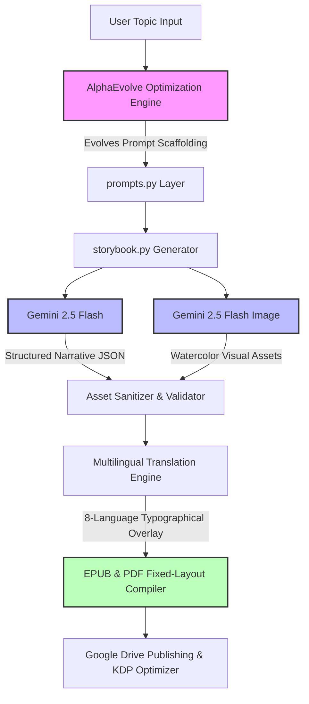

# The Autonomous AI Children's Book Publishing Ecosystem 🤖👧📖

Welcome to the **Autonomous AI Children's Book Publishing Ecosystem**, an advanced full-stack suite of AI pipelines and mathematical optimization engines designed to compose, illustrate, localize, and publish beautiful, print-ready children's books and eBooks.

Leveraging the **Google GenAI SDK (Gemini-2.5-Flash)**, **Vertex AI**, and **DeepMind's AlphaEvolve** frameworks, this ecosystem autonomous generates high-fidelity narrative arcs, ensures strict character and visual asset consistency, and converts storylines into multi-lingual fixed-layout publishing formats.

## 🗺️ Architectural Ecosystem Overview

## 🚀 Ecosystem Core Components

### 1. [**story-agent**](https://github.com/enriquekalven/story-agent) — The Autonomous Publishing Engine
The production orchestrator responsible for the E2E generation and manuscript compilation lifecycle.
* **Unified Artwork Orchestration:** Weaves AlphaEvolve visual prompt defaults for recurring characters (**Lily** and **Robo**) with premium textless watercolor illustration style parameters.
* **Multilingual Translation Layer:** Outputs, typesets, and wraps books across English, Spanish, Portuguese, French, Japanese, Korean, Italian, and German.
* **Turnkey Compilers:** Generates print-ready PDFs and KDP-compatible fixed-layout EPUB eBooks directly to Google Drive.

### 2. [**story-agent-evolve**](https://github.com/enriquekalven/story-agent-evolve) — Narrative & Visual Optimization Suite
Powered by DeepMind's AlphaEvolve mathematical hill-climbing search engine.
* **Score Climb (7.45 → 8.91):** Evolved prompt engineering defaults using a multi-rung evaluation ladder to maximize original story arcs, sensory engagement, and strict visual asset alignment.
* **Regex Prompt Sanitization:** Automatically parses and strips watermarks, artist signatures, and prompt leaks to guarantee pristine image generation.

### 3. [**story-agent-evolve-kdp**](https://github.com/enriquekalven/story-agent-evolve-kdp) — Conversion Rate & Listing Optimizer
A specialized composite multi-objective evaluation pipeline for Amazon KDP optimization.
* **LLM-as-a-Judge Critic:** Executes a signal-guarded evaluation cascade scoring candidate KDP description templates on **Hook Virality**, **Pedagogical STEM Relevance**, and **SEO scannability**.

## 🛠️ Technology Stack & Frameworks

* **Large Language Models:** Google GenAI SDK (Gemini-2.5-Flash, Gemini-2.5-Flash-Image)
* **Optimization Engine:** DeepMind AlphaEvolve Cloud API (MAP Elites & Evolutionary Islands architecture)
* **Image Processing & Typography:** Pillow (PIL), dynamic line-wrapping for Asian (CJK) vs. Western space-separated languages.
* **Ecosystem Management:** `uv` by Astral (Fast Python dependency and venv orchestrator)
* **Cloud Infrastructure:** Google Cloud Vertex AI, Google Auth (ADC), Google Drive API, Google Cloud Text-to-Speech (Neural2).

## 📊 Evaluation & Metrics
The ecosystem utilizes a robust **Three-Tier Evaluator Structure** (Validation, Verification, and Evaluation) to guide evolutionary convergence and prevent reward-hacking across its generation pipelines.

> [!NOTE]
> All primary metrics are mathematically mapped to monotonic hill-climbing scalar scores, negated automatically for minimization objectives like latency or error rates.

***

**Designed with ❤️ by Enrique Chan**
"Making learning and storytelling an absolute blast for the next generation."
